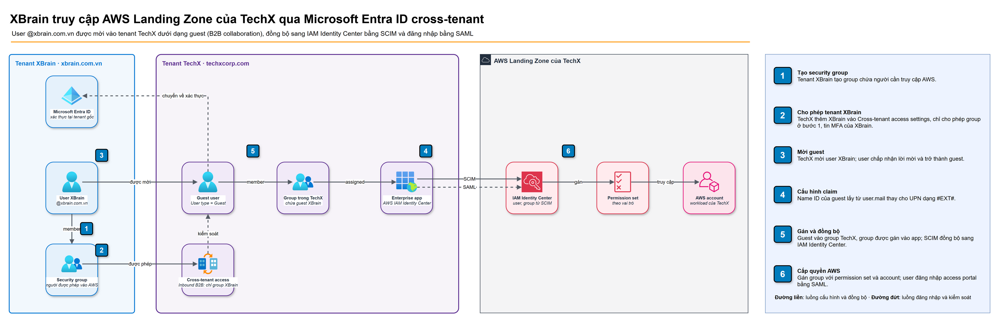
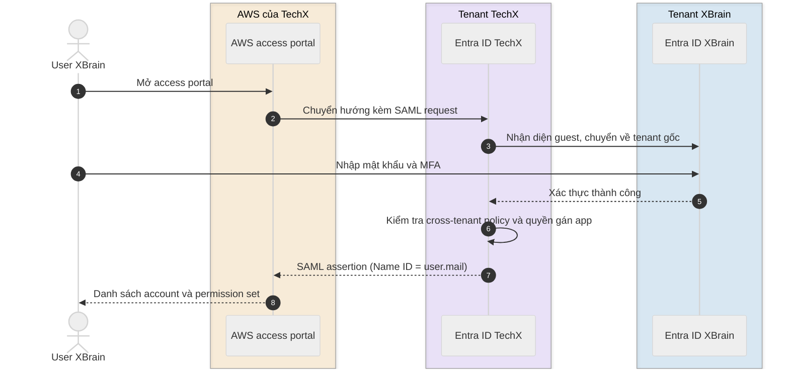
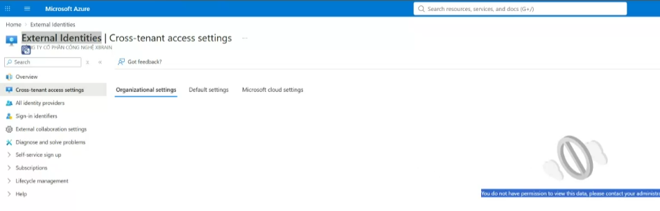

# Cho phép user XBrain đăng nhập AWS Landing Zone qua Microsoft Entra ID của TechX

> **Tóm tắt**
> User XBrain truy cập AWS Landing Zone của TechX dưới dạng guest (B2B collaboration) trong tenant Entra ID của TechX, đăng nhập bằng tài khoản `@xbrain.com.vn`. Quy trình gồm 6 bước; thời gian chờ chủ yếu nằm ở chu kỳ provisioning sang IAM Identity Center (khoảng 40 phút, có thể rút ngắn bằng Provision on demand).

*Trang này giả định IAM Identity Center của AWS Landing Zone đã được kết nối với tenant Microsoft Entra ID của TechX bằng SAML và SCIM.*

AWS Landing Zone dùng tenant Microsoft Entra ID của TechX (`techxcorp.com`) làm identity source cho IAM Identity Center. User của XBrain có tài khoản ở một tenant khác (`xbrain.com.vn`). Trang này hướng dẫn cách đưa user XBrain vào tenant TechX dưới dạng guest (B2B collaboration), để họ đăng nhập AWS access portal bằng chính tài khoản XBrain.

Mỗi instance IAM Identity Center chỉ có một identity source, vì vậy không thể thêm tenant XBrain làm identity source thứ hai. Để biết thêm, xem [Manage your identity source](https://docs.aws.amazon.com/singlesignon/latest/userguide/manage-your-identity-source.html).

## Cách hoạt động

*Nguồn sơ đồ: [`cross-tenant-architecture.drawio`](../images/cross-tenant-architecture.drawio), mở bằng draw.io để chỉnh sửa.*

1. Admin tenant XBrain tạo security group chứa người cần truy cập AWS.
2. Admin TechX cho phép tenant XBrain trong **Cross-tenant access settings**, chỉ áp dụng cho group ở bước 1.
3. Admin TechX mời user XBrain. Mỗi user trở thành một guest user trong tenant TechX.
4. Guest user được thêm vào một group trong tenant TechX; group được gán vào enterprise application **AWS IAM Identity Center** và đồng bộ sang IAM Identity Center bằng SCIM.
5. Enterprise application được cấu hình để guest dùng `user.mail` làm Name ID trong SAML assertion.
6. Group được gán với permission set và AWS account. Khi đăng nhập, Entra ID của TechX chuyển user về tenant XBrain để xác thực, sau đó gửi SAML assertion về IAM Identity Center như sơ đồ dưới đây.

## Điều kiện tiên quyết

Trước khi bắt đầu, hãy đảm bảo:

- Ở tenant TechX, bạn có role **Security Administrator** (để sửa cross-tenant access settings) và **Cloud Application Administrator** (để gán user vào enterprise application).
- Ở tenant XBrain, bạn có role **Groups Administrator** để tạo security group.
- Bạn có tenant ID hoặc domain của tenant XBrain.

> **Quan trọng**
> Tài khoản không có role Security Administrator sẽ nhận thông báo *You do not have permission to view this data* khi mở **Cross-tenant access settings**.

> **Lưu ý**
> Đường dẫn **External Identities** > **Cross-tenant access settings** > **Organizational settings** đã được đối chiếu trên console. Các tên menu còn lại ở Bước 2 và Bước 3 được viết theo tài liệu Microsoft và sẽ được cập nhật theo ảnh chụp khi thực hiện trên tenant TechX.

## Bước 1: Tạo security group ở tenant XBrain

**Để tạo security group**

1. Đăng nhập [Microsoft Entra admin center](https://entra.microsoft.com) của tenant XBrain.
2. Chọn **Groups** > **All groups** > **New group**.
3. Trong **Group type**, chọn **Security**. Trong **Membership type**, chọn **Assigned**.
4. Nhập tên group, thêm các user cần truy cập AWS, sau đó chọn **Create**.
5. Mở group vừa tạo và ghi lại **Object ID**. Bạn cần giá trị này ở Bước 2.

## Bước 2: Cho phép tenant XBrain trong cross-tenant access settings của TechX

**Để thêm tenant XBrain**

1. Đăng nhập Microsoft Entra admin center của tenant TechX.
2. Chọn **External Identities** > **Cross-tenant access settings**.
3. Chọn tab **Organizational settings**, sau đó chọn **Add organization**.
4. Nhập tenant ID hoặc domain `xbrain.com.vn`, sau đó chọn **Add**.

**Để giới hạn user XBrain được phép vào**

1. Trong danh sách organization, chọn **Inherited from default** ở cột **Inbound access** của XBrain.
2. Chọn tab **B2B collaboration**, sau đó chọn **Customize settings**.
3. Trong **External users and groups**, chọn **Allow access** và **Select external users and groups**.
4. Chọn **Add external users and groups**, nhập Object ID của group ở Bước 1, sau đó chọn **Save**.

**Để tin MFA của tenant XBrain (khuyến nghị)**

1. Trong cùng trang, chọn tab **Trust settings**.
2. Chọn **Trust multifactor authentication from Microsoft Entra tenants**, sau đó chọn **Save**.

> **Lưu ý**
> Nếu không bật trust MFA, user XBrain phải đăng ký thêm MFA ở tenant TechX trong lần đăng nhập đầu tiên.

Để biết thêm, xem [Cross-tenant access overview](https://learn.microsoft.com/en-us/entra/external-id/cross-tenant-access-overview).

## Bước 3: Mời user XBrain vào tenant TechX

**Để mời user**

1. Trong Microsoft Entra admin center của tenant TechX, chọn **Users** > **All users** > **New user** > **Invite external user**.
2. Nhập email `@xbrain.com.vn` của user, sau đó chọn **Review + invite** > **Invite**.
3. User mở email mời và chấp nhận lời mời.

> **Lưu ý**
> Nếu user không nhận được email, mở guest user trong tenant TechX, copy link mời và gửi trực tiếp cho user. Nếu user báo lỗi khi chấp nhận, kiểm tra user đã là member của group ở Bước 1 chưa.

**Để xác minh**

- Trong tenant TechX, mở user và kiểm tra **User type** là **Guest** và **Invitation state** là **Accepted**.

## Bước 4: Gán guest user vào AWS IAM Identity Center

**Để gán user và đồng bộ**

1. Trong tenant TechX, tạo một security group cho guest user XBrain và thêm các guest vào group. Tên group cần khác với group ở tenant XBrain để tránh nhầm lẫn khi gán quyền, ví dụ `techx-aws-xbrain-devops` (tên chính thức chờ chốt).
2. Chọn **Enterprise applications** > **AWS IAM Identity Center** > **Users and groups** > **Add user/group**, chọn group vừa tạo, sau đó chọn **Assign**.
3. Chọn **Provisioning** > **Provision on demand** để đồng bộ ngay, hoặc đợi chu kỳ đồng bộ tiếp theo (khoảng 40 phút). Để biết thêm, xem [How provisioning works](https://learn.microsoft.com/en-us/entra/identity/app-provisioning/how-provisioning-works).

> **Quan trọng**
> Provisioning service không đọc nested group. Chỉ user là member trực tiếp của group được gán mới được đồng bộ. Group của tenant XBrain không thể gán trực tiếp vào enterprise application của tenant TechX.

## Bước 5: Cấu hình claim cho guest user

Email của guest user có dạng `exampleuser_domain.com#EXT#@domain.onmicrosoft.com`. IAM Identity Center không chấp nhận định dạng `#EXT#`, vì vậy cần map `Name ID` của guest sang thuộc tính `user.mail`. Để biết thêm, xem [Microsoft Entra ID Guest Account Synchronization](https://docs.aws.amazon.com/singlesignon/latest/userguide/idp-microsoft-entra.html).

**Để cấu hình claim**

1. Trong tenant TechX, chọn **Enterprise applications** > **AWS IAM Identity Center** > **Single sign-on**.
2. Chọn **Edit** bên cạnh **Attributes & Claims**.
3. Chọn **Unique User Identifier (Name ID)**.
4. Tạo hai claim condition:
   - User type **Members**: source attribute `user.userprincipalname`.
   - User type **External guests**: source attribute `user.mail`.
5. Chọn **Save**.

## Bước 6: Xác minh truy cập AWS

**Để xác minh**

1. Trong IAM Identity Center, chọn **Users** và kiểm tra guest user đã xuất hiện.
2. Gán group vào AWS account với permission set tương ứng.
3. User mở AWS access portal, đăng nhập bằng tài khoản `@xbrain.com.vn` và kiểm tra thấy đúng account.

## Phương án đã loại

| Phương án | Lý do loại |
|---|---|
| Tạo tài khoản `@techxcorp.com` cho từng người XBrain | Mỗi người có hai tài khoản và hai mật khẩu; khi nghỉ việc ở XBrain, tài khoản TechX không tự bị khoá |
| Thêm tenant XBrain làm identity source thứ hai | IAM Identity Center chỉ hỗ trợ một identity source cho mỗi instance |

## Xử lý sự cố

**"You do not have permission to view this data" ở Cross-tenant access settings**
Tài khoản thiếu role Security Administrator ở tenant đó. Xin cấp role hoặc nhờ admin của tenant thực hiện.

**Guest user không đăng nhập được AWS access portal**
Kiểm tra claim condition cho External guests ở Bước 5.

**User không xuất hiện trong IAM Identity Center**
Kiểm tra user là member trực tiếp của group đã gán ở Bước 4, sau đó chạy **Provision on demand** và xem **Provisioning logs**.

## Câu hỏi mở

1. Dùng B2B invitation (mời thủ công) hay cross-tenant synchronization (tự tạo và tự xoá guest theo group ở tenant XBrain)? Cross-tenant synchronization cần cấu hình outbound ở tenant XBrain. Xem [Cross-tenant synchronization](https://learn.microsoft.com/en-us/entra/identity/multi-tenant-organizations/cross-tenant-synchronization-overview).
2. Khi một người nghỉ việc ở XBrain, ai xoá guest user ở tenant TechX? Có access review định kỳ không?
3. Sáu group `xbrain-aws-*` ở tenant XBrain dùng làm nguồn cho Bước 1, hay cần tạo group tương ứng trong tenant TechX ở Bước 4?

## Bước tiếp theo

- [Assign user access to AWS accounts](https://docs.aws.amazon.com/singlesignon/latest/userguide/assignusers.html)
- [Configure SAML and SCIM with Microsoft Entra ID and IAM Identity Center](https://docs.aws.amazon.com/singlesignon/latest/userguide/idp-microsoft-entra.html)
