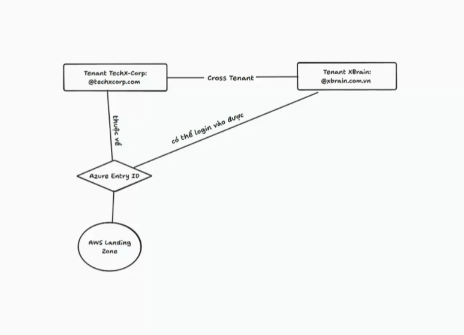
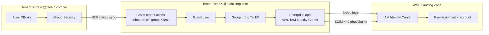
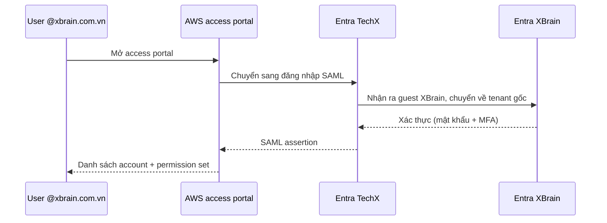

# 01 · Cross-tenant access: XBrain đăng nhập AWS Landing Zone của TechX

**Người soạn:** Nguyễn Đình Thi · **Trạng thái:** Chờ review · **Người đọc:** người review, team XBrain cần vào AWS

## 1. Bài toán

- AWS Landing Zone dùng Entra ID của tenant **TechX** (`@techxcorp.com`) làm IdP cho IAM Identity Center (SAML + SCIM).
- Team XBrain có tài khoản ở tenant **XBrain** (`@xbrain.com.vn`).
- Cần: user XBrain đăng nhập AWS bằng chính tài khoản XBrain, không cấp thêm tài khoản `@techxcorp.com`.

## 2. Giải pháp

User XBrain được đưa vào tenant TechX dưới dạng **guest (B2B)**. TechX gán guest vào app AWS, SCIM đẩy user sang IAM Identity Center.

**Phương án đã loại**

| Phương án | Lý do loại |
|---|---|
| Tạo tài khoản `@techxcorp.com` cho từng người XBrain | Mỗi người 2 tài khoản, 2 mật khẩu; nghỉ việc ở XBrain không tự khoá tài khoản TechX |
| Nối thêm IdP XBrain vào IAM Identity Center | Mỗi instance IIC chỉ có 1 identity source [Fact](https://docs.aws.amazon.com/singlesignon/latest/userguide/manage-your-identity-source.html) |

## 3. Các bước

### A. Cho phép tenant XBrain vào TechX

| # | Làm ở đâu | Ai làm (role cần) | Việc | Vì sao | Kiểm tra xong |
|---|---|---|---|---|---|
| A1 | Tenant XBrain | Groups Administrator | Tạo group Security chứa user XBrain cần vào AWS | Giới hạn chỉ group này được vào TechX | Group có đủ member |
| A2 | Entra TechX → External Identities → Cross-tenant access settings → Organizational settings | Security Administrator (TechX) | Add organization: nhập tenant ID hoặc domain `xbrain.com.vn` | Khai báo tenant đối tác | XBrain xuất hiện trong danh sách |
| A3 | Như trên → XBrain → Inbound access → B2B collaboration | Security Administrator (TechX) | Chọn "Select external users and groups", nhập Object ID group ở A1 | Chặn mọi user XBrain khác | Chỉ group A1 được Allow |
| A4 | Như trên → Trust settings | Security Administrator (TechX) | Tin MFA của tenant XBrain [Recommendation] | User không phải đăng ký MFA lần 2 | Đăng nhập không hỏi đăng ký MFA mới |

### B. Đưa user XBrain thành guest

| # | Làm ở đâu | Ai làm | Việc | Vì sao | Kiểm tra xong |
|---|---|---|---|---|---|
| B1 | Tenant XBrain | Groups Administrator | Thêm user vào group A1 | Chỉ member group mới được mời | User có trong group |
| B2 | Entra TechX → Users → New user → Invite external user | Guest Inviter / User Administrator (TechX) | Mời user bằng email `@xbrain.com.vn` | Tạo guest object trong TechX | User type = Guest |
| B3 | Mail của user | User | Bấm link chấp nhận. Không có mail: copy link invite ở B2 gửi user | Hoàn tất redeem | Invitation state = Accepted |

Lỗi khi chấp nhận: kiểm tra lại user đã nằm trong group A1 chưa.

### C. Cấp quyền AWS

| # | Làm ở đâu | Ai làm | Việc | Vì sao | Kiểm tra xong |
|---|---|---|---|---|---|
| C1 | Entra TechX → Enterprise apps → AWS IAM Identity Center → Users and groups | Cloud Application Administrator (TechX) | Gán guest (hoặc group trong TechX chứa guest) vào app | Chỉ user được gán mới SCIM sang AWS | User/group có trong danh sách |
| C2 | Như trên → Provisioning | Như trên | Provision on demand, hoặc chờ chu kỳ ~40 phút [Fact](https://learn.microsoft.com/en-us/entra/identity/app-provisioning/how-provisioning-works) | Đẩy user sang IIC | Provisioning log Success |
| C3 | AWS IAM Identity Center → Users | Admin IIC | Kiểm tra user, gán vào group / permission set | User có quyền vào account | User đăng nhập access portal thấy account |

## 4. Lỗi thường gặp

| Lỗi | Nguyên nhân | Cách xử lý |
|---|---|---|
| "You do not have permission to view this data" ở Cross-tenant access settings | Tài khoản thiếu role Security Administrator ở tenant đó | Xin role, hoặc nhờ admin tenant làm |
| User không nhận mail invite | Mail bị lọc | Copy link invite ở B2 gửi trực tiếp |
| User không xuất hiện ở IIC | Chưa gán vào app, hoặc chưa tới chu kỳ provisioning | Kiểm tra C1, chạy Provision on demand |

## 5. Câu hỏi mở

1. Dùng **B2B invite** (mời tay) hay **Cross-tenant sync** (tự tạo và tự xoá guest khi đổi group ở XBrain)? Cross-tenant sync cần bật Outbound ở XBrain và "Allow users sync into this tenant" ở TechX [Fact](https://learn.microsoft.com/en-us/entra/identity/multi-tenant-organizations/cross-tenant-synchronization-overview).
2. Group gán vào app AWS ở C1 là group nào? Group của tenant XBrain không gán được vào app của tenant TechX, cần một group trong TechX chứa guest.
3. Thuộc tính `userName` khi SCIM guest sang IIC map từ `mail` hay UPN? UPN của guest có dạng `user_xbrain.com.vn#EXT#@...` [Assumption, cần test].
4. TechX có bật trust MFA từ XBrain (A4) không?
5. Offboarding: ai xoá guest ở TechX khi người XBrain nghỉ? Có access review định kỳ không?
6. Phía XBrain ai giữ role Security Administrator để cấu hình Outbound (nếu chọn sync)?
7. 6 group `xbrain-aws-*` đã tạo ở tenant XBrain dùng làm nguồn cho A1, hay cần dựng lại group tương ứng trong TechX?

## Nguồn

- [Fact] Cross-tenant access overview – https://learn.microsoft.com/en-us/entra/external-id/cross-tenant-access-overview
- [Fact] B2B collaboration – https://learn.microsoft.com/en-us/entra/external-id/what-is-b2b
- [Fact] Cross-tenant synchronization – https://learn.microsoft.com/en-us/entra/identity/multi-tenant-organizations/cross-tenant-synchronization-overview
- [Fact] Entra provisioning cycle – https://learn.microsoft.com/en-us/entra/identity/app-provisioning/how-provisioning-works
- [Fact] Entra ↔ AWS IAM Identity Center provisioning – https://learn.microsoft.com/en-us/entra/identity/saas-apps/aws-single-sign-on-provisioning-tutorial
- [Fact] IIC identity source – https://docs.aws.amazon.com/singlesignon/latest/userguide/manage-your-identity-source.html
