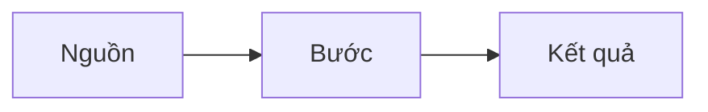

# NN · Tên doc

**Người soạn:** Nguyễn Đình Thi · **Trạng thái:** Nháp / Chờ review / Đã duyệt · **Người đọc:** review / vận hành

## 1. Bài toán

Một đoạn 2–3 câu: hiện trạng, cần đạt gì, ai dùng.

## 2. Giải pháp

Phương án đã chọn và lý do. Phương án đã loại và lý do loại.

## 3. Các bước

| # | Làm ở đâu | Ai làm (role cần) | Việc | Vì sao | Kiểm tra xong |
|---|---|---|---|---|---|
| 1 | | | | | |

## 4. Lỗi thường gặp

| Lỗi | Nguyên nhân | Cách xử lý |
|---|---|---|

## 5. Câu hỏi mở

1.

## Nguồn

- [Fact] tiêu đề – link
