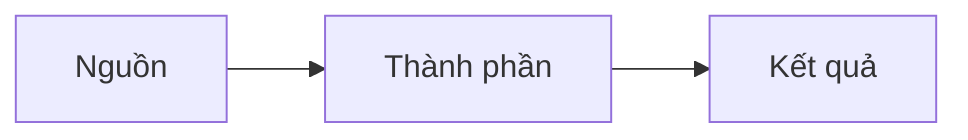

# <Động từ + kết quả, ví dụ: Cho phép user X đăng nhập Y>

*Trang này giả định <điều kiện đã có sẵn>.*

<Đoạn mở bài 2–4 câu: hiện trạng, trang này hướng dẫn làm gì, kết quả sau khi làm.> Để biết thêm, xem [<tiêu đề tài liệu chính thức>](<link>).

## Cách hoạt động

1. <Bước của luồng, viết ở thì hiện tại.>
2.

## Điều kiện tiên quyết

Trước khi bắt đầu, hãy đảm bảo:

- Bạn có role **<role>** ở <nơi>.
-

> **Quan trọng**
> <Điều sẽ làm hỏng hoặc chặn quy trình nếu bỏ qua.>

## Bước 1: <Động từ + đối tượng>

**Để <làm việc gì>**

1. Đăng nhập <console>.
2. Chọn **<Menu>** > **<Mục>**.
3.

> **Lưu ý**
> <Thông tin phụ, cách xử lý tình huống thường gặp.>

**Để xác minh**

- <Kết quả nhìn thấy được trên console.>

## Bước 2: <Động từ + đối tượng>

## Phương án đã loại

| Phương án | Lý do loại |
|---|---|
| | |

## Xử lý sự cố

**<Thông báo lỗi hoặc triệu chứng>**
<Nguyên nhân. Cách xử lý.>

## Bước tiếp theo

- [<Trang liên quan>](<link>)
